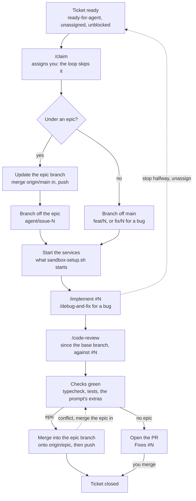

# Building a ticket yourself

The agent loop builds `ready-for-agent` tickets on its own, but every step it takes is a skill or a git command you can run yourself, in Claude Code, on one ticket. Do it when you want to watch or steer the work: a ticket you want to understand, one that keeps failing in the loop, or a day the loop is off.

For a whole epic you'd rather build by hand, put the `manual` label on it instead: the loop then never plans it or touches its tickets (see [How work flows](workflow.md)).

For a whole `manual` epic you'd rather have built *here*, in a Claude Code session you can watch, run `/run-epic <epic>`: it takes the epic's tickets through this same pipeline one at a time (the loop's prompts, the same claim, branch and landing), hands back what it can't build, and opens the epic's PR at the end.

## What the loop does with a ticket

1. **Queue.** It takes open issues labelled `ready-for-agent` (or `ready-for-agent-debugging` for a bug) that have no assignee and no open blocker.
2. **Plan.** A planner agent picks the tickets that can be built side by side with each other and with the ones already running, up to the free slots.
3. **Claim and branch.** It assigns the ticket to you (an assignee means *claimed*), then makes its branch: `agent/issue-N` off the epic's branch, after merging `main` into it; or `feat/N` (`fix/N` for a bug) off `main` for a ticket with no epic.
4. **Build.** In a Docker sandbox with dependencies installed and the project's services running (`.sandcastle/sandbox-setup.sh`), an agent follows `/implement` (`/debug-and-fix` for a bug): tests first, then the code, typecheck and tests green, commits on the branch.
5. **Review.** A second agent, in the same sandbox, runs `/code-review` on the branch and commits its fixes.
6. **Land.** Under an epic, the branch merges into the epic branch and the ticket closes. Otherwise it gets a PR with `Fixes #N`, for you to merge. A build that ends with no commits means the agent couldn't finish: it has said why on the issue, and the ticket goes to `ready-for-human`.

## Doing it by hand



Replace `N` with the ticket number and `epic/NN-slug` with its epic's branch, written in the epic's body as **Branch:**. The commands use `npm`; use your project's package manager.

### 1–2. Claim it and make the branch: `/claim`

```
/claim        # the next available ticket, in build order
/claim 42     # ticket #42
```

[`/claim`](../skills/engineering/claim/SKILL.md) does both steps the way the loop does, and stops on anything it shouldn't decide alone (uncommitted changes, a blocked ticket, a merge conflict):

1. **Claims it**: assigns you. The loop only takes unassigned tickets, so it can keep running beside you.
2. **Makes the branch.** Under an epic: merges `origin/main` into the epic branch and pushes it, then branches `agent/issue-N` off it. With no epic: branches `feat/N` (`fix/N` for a bug) off `main`. A branch the loop already started is reused, with its commits.
3. **Switches you to it**, and lists the next steps for that ticket.

By hand, without the skill:

```sh
gh issue edit N --add-assignee @me
git fetch origin
# Under an epic. The loop may have the epic branch checked out in a worktree of
# its own, so update it without checking it out here:
git switch --detach origin/epic/NN-slug
git merge origin/main && git push origin HEAD:epic/NN-slug
git switch -c agent/issue-N origin/epic/NN-slug
# With no epic:
git switch -c feat/N origin/main      # fix/N for a bug
```

### 3. Start what the sandbox would have

Install dependencies, then start the services `.sandcastle/sandbox-setup.sh` starts in the sandbox (a database, a cache, migrations and seed data) with your project's own dev commands.

### 4. Build it

In Claude Code, in the repo:

```
/implement #N
```

For a bug, `/debug-and-fix #N`. It's the same skill the loop's agent follows; the difference is that it can ask you when something's unclear.

### 5. Review it

```
/code-review since origin/epic/NN-slug, against issue #N
```

(`since origin/main` for a ticket with no epic.) Fix what it finds.

### 6. Run the checks the loop requires

The project's typecheck and tests, green, plus anything the project's `implement-prompt.md` adds (integration tests, a generated-client check).

### 7. Land it

Under an epic, onto the latest epic branch (the loop may have landed other tickets meanwhile), without checking the epic branch out:

```sh
git fetch origin
git switch --detach origin/epic/NN-slug
git merge --no-edit agent/issue-N
git push origin HEAD:epic/NN-slug
gh issue close N --comment "Landed on epic/NN-slug."
git switch main
```

With no epic, open the PR the loop would have:

```sh
git push -u origin feat/N
gh pr create --fill --body "Fixes #N"
```

## Good to know

- **You're the loop here.** The "don't push, don't close the issue" rules in `.sandcastle/implement-prompt.md` are for the sandboxed agents; by hand, pushing and closing are yours.
- **Conflicts.** If the merge in step 7 conflicts, `git merge --abort`, switch back to your branch, merge the epic branch into it (`git merge origin/epic/NN-slug`), resolve, and run step 6 again. The loop does the same by retrying the ticket on top of the latest epic branch.
- **Stopping halfway.** Commit, `git switch main` (the loop can't use a branch checked out in your checkout), then unassign yourself (`gh issue edit N --remove-assignee @me`): the loop picks the ticket up again, from the commits already on its branch.
- **Watching the real loop instead.** `npm run agents -- --once` runs one full pass (plan, build what's ready, land) and exits. Stop a running loop first: two loops on one checkout fight over the same tickets.

## Steering the loop without building

| You want | Do |
| --- | --- |
| The loop to leave a ticket alone | Assign yourself, or remove `ready-for-agent` |
| The loop to take a ticket | Add `ready-for-agent` and leave it unassigned |
| Nobody to touch it for now | Add `backlog` |
| To build a whole epic yourself | Add `manual` to the epic |
